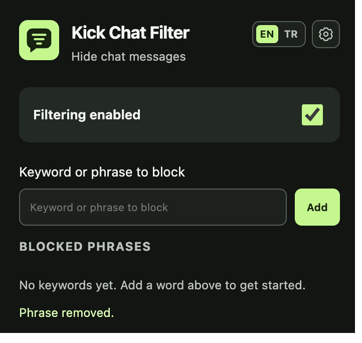
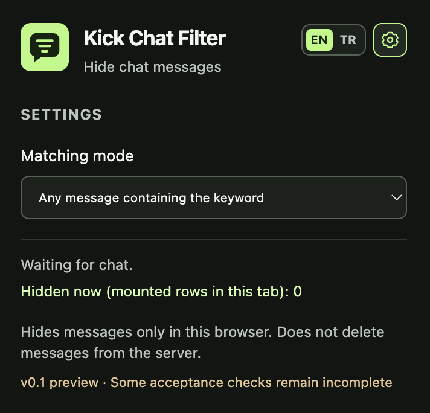

# Kick Chat Filter — 0.1.0 preview

A small Manifest V3 extension that hides Kick chat rows when their **message bodies** contain a blocked word or phrase. Runs locally, with an English-default popup and a saved Turkish option and no runtime dependencies, accounts, telemetry, background worker or network requests.

**Release status:** live DOM selectors and basic installed Chrome filtering have been verified on 2026-10-27. This is a preview, not a completed v1 acceptance release. Exact live `Ahmet bugün yayında mı?`, browser-restart persistence, extended scroll/traffic/layout coverage and Firefox still need verification. See [validation](docs/VALIDATION.md) and [selector evidence](docs/PHASE_A.md).

## Screenshots

The popup lets you manage blocked words and phrases, toggle filtering, and switch between English and Turkish. Settings include the matching mode and the current tab's hidden-message count.

| Main popup | Settings |
| --- | --- |
|  |  |

## Install in Chrome / Chromium

1. Open `chrome://extensions` and enable Developer mode.
2. Click **Load unpacked** and choose this `kick-chat-filter` directory (the one containing `manifest.json`). No build or npm install is needed to use it.
3. Refresh already-open Kick tabs. New Kick tabs load the extension automatically.
4. Open **Kick Chat Filter** from the toolbar. Enter a term and press Enter or **Add**. Use **Remove** to remove a term and **Filtering enabled** to enable/disable filtering. Use the compact **EN / TR** toggle at the top right for Turkish; the choice is saved locally.

After editing source, reload the extension on `chrome://extensions`, then refresh Kick tabs. Removing the extension removes its settings; refresh Kick afterward to clear any marker styles left in an existing document.

## Behavior

- Default: substring matching. `ahmet` matches `Ahmet burada` and `ahmetler`. Optional **Whole words only** excludes the latter.
- Multiple rules use OR. Empty terms are rejected; outer spaces are trimmed and equivalent terms deduplicated. Inner spaces are preserved exactly.
- Unicode NFC plus `toLocaleLowerCase('tr')`, followed by NFC. `İ/i` and `I/ı` are respective pairs. Accents are preserved. This is a deliberately Turkish policy: uppercase English `KICK` folds to `kıck`, so it does not match lowercase `kick`. Store the intended Turkish spelling rather than expecting English case folding.
- Whole-word/phrase mode requires both external neighbors to be absent or outside Unicode letters, combining marks, numbers and underscore. Punctuation, apostrophes, emoji and URL separators are boundaries. `ahmet'in` matches `ahmet`; `_ahmet` does not. Phrases keep their exact internal whitespace.
- Reads only the verified body span. Sender identity, timestamps, badges, reply quotes, pinned controls and menu labels never form matching input. Inline mention text within a body counts as part of that body.
- Rendered image emotes and SVGs are skipped, replacing each with a separator; their alt/name text is not a keyword. Unicode emoji remain matchable. `ah[emote]met` does not become `ahmet`.
- Hides the complete individual row with an extension-owned CSS marker. Never deletes Kick nodes, moderates users or changes the server's chat. Disabling/removing rules restores rows still in the DOM.
- Counter: **currently hidden mounted DOM rows in this tab**, not a lifetime/session total. Repeat scans do not inflate it. Virtualized removal lowers it; navigation/root replacement reconciles it. Offscreen history not mounted by Kick is not counted.
- Settings use `storage.local`, update all applicable tabs through `storage.onChanged`, and remain saved across page reloads. Schema 1 is canonical; version 0/unversioned `blockedTerms` is normalized on read and saved as schema 1 at the next edit. Unsupported future versions disable filtering rather than guessing. Concurrent edits from separate popup windows use last-write-wins browser storage semantics.

## Development and tests

Use a supported Node.js release, preferably Node 22 LTS or newer, and npm:

```sh
npm ci --ignore-scripts
npm test
npm run check
npm run test:performance
```

`node:test` is the test runner; jsdom is a **development-only** DOM fixture dependency. No bundler or build step. `package-lock.json` pins dependencies. `npm run check` checks source syntax, referenced package files, permissions and obvious network/HTML-execution APIs.

Source order is declared directly in the manifest. Pure matching/settings helpers populate an isolated `KCF` namespace; the adapter contains all Kick selectors. The controller performs an initial root-only scan, deduplicates changed rows per animation frame and observes child/text changes and selected structural attributes. A 750ms root/path lookup handles late mount, same-root navigation and replacements without a permanent document observer. Disconnection clears pending work and restores owned markers. Background-tab queues discard detached rows even when animation frames are suspended.

## Troubleshooting / limitations

A waiting status can mean closed/unmounted chat or unsupported markup. A selector warning means unrecognized rows were left visible. Refresh after installing/reloading. New chat roots can take up to roughly 750ms plus browser scheduling to attach; streaming rows normally process at the next animation frame. Brief exposure is possible, especially on busy/background tabs; no universal flicker guarantee is made.

Only the ordinary channel chat and the specific reply form inspected in Phase A are targeted. Special event/system layouts fail open. Dashboard, pop-out, theater/full-screen, paused/scroll-up history and other enhanced layouts require additional manual coverage. Mo'Kick 3.3.1 was enabled during Chrome checks; this is a limited coexistence result, not a guarantee for every Mo'Kick setting. Firefox has not been tested or packaged separately.

See [privacy](PRIVACY.md), [release notes](RELEASE_NOTES.md) and the supplied [implementation plan](KICK_CHAT_FILTER_PLAN.md).

The interface language does not change the documented Turkish keyword normalization policy. Existing settings without a language preference default to English.

The home view contains only the filtering toggle, keyword entry and blocked phrases. Use the gear button to the right of EN / TR to open Settings for matching mode, chat status and privacy information. Press Escape or the gear again to return home.
